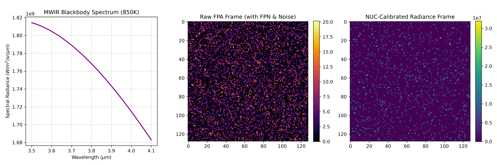
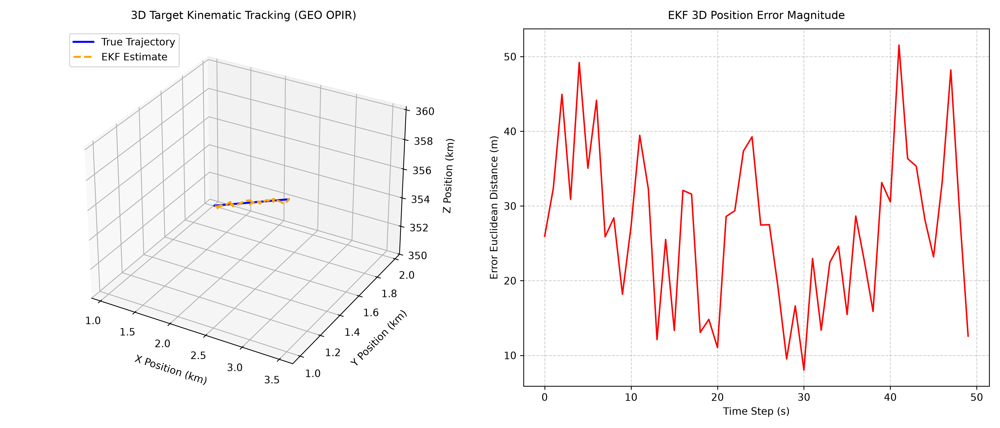

# OPIR Simulated Sensor & Processing Pipeline

## Overview
A production-grade, simulated Overhead Persistent Infrared (OPIR) data processing pipeline built for Geostationary Earth Orbit (GEO) staring sensor architectures (~35,786 km altitude). This repository demonstrates core technical proficiencies in MWIR radiometry, focal plane array (FPA) noise modeling, Two-Point Non-Uniformity Correction (NUC), hierarchical data serialization (NetCDF4), and 3D kinematics/Extended Kalman Filtering.

---

## Architecture & Modules

### Module 1: Radiometric & Spectral Response Physics (`radiometry.py`)



* **Planck Integration:** Numerical integration (`scipy.integrate.quad`) of blackbody spectral radiance across the MWIR band ($3.5 - 4.1\ \mu m$) targeting high-temperature plume signatures ($800\text{--}1500\text{ K}$).
* **FPA Noise Modeling:** Root-sum-square (RSS) noise budget combining:
  * *Photon Shot Noise:* Poisson-distributed quantum uncertainty ($\sigma = \sqrt{N_{\text{ph}}}$).
  * *Dark Current Noise:* Thermally generated semiconductor electron noise scaled by integration time.
  * *Read Noise:* Additive Gaussian noise from the Readout Integrated Circuit (ROIC).
* **Two-Point NUC:** Eliminates Fixed Pattern Noise (FPN) by computing per-pixel linear gain and offset calibration matrices from cold and hot reference blackbody frames.
* **Hierarchical I/O:** Serializes raw FPA counts, calibrated radiance, and NUC matrices into professional NetCDF4 data cubes.

### Module 2: 3D Kinematics & EKF Tracking (`ekf_tracker.py`)



* **State Estimation:** Tracks a 6-state target kinematic vector $\mathbf{x} = [x, y, z, v_x, v_y, v_z]^T$ under constant velocity dynamics.
* **Non-Linear Tracking & EKF:** Uses Jacobian linearization to handle spherical-to-Cartesian measurement transformations and propagates error covariance matrices ($P_k$) to quantify uncertainty under low-SNR conditions.
* **Performance Validation:** Generates robust diagnostic visualizations tracking true vs. estimated trajectories and Euclidean position error.

---

## Installation & Usage
1. Clone the repository and set up a Python virtual environment (`pyenv` recommended):
   ```bash
   pyenv virtualenv 3.14.6 remote_sensing
   pyenv activate remote_sensing
   pip install numpy scipy matplotlib netCDF4 h5py